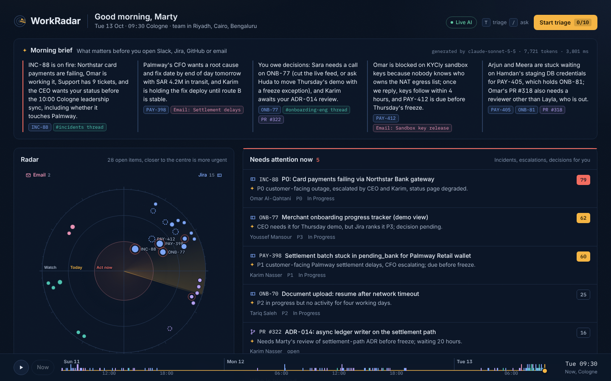

# WorkRadar

One screen that tells an engineering manager, in under a minute, what to work on today, what happened, what needs attention now and who is blocked, without opening Slack, Jira, GitHub or email.

Live app: https://work-radar-theta.vercel.app



## The scenario

Marty McFly is an Engineering Manager at Darb Pay, a fictional fintech headquartered in Cologne on the Rhine. His eight engineers work in two squads across Riyadh, Cairo and Bengaluru. When he logs in at 09:30 Cologne time on Tuesday 13 October, Bengaluru has been working for four hours and the Riyadh team has already had a full Sunday he never saw.

The demo clock is fixed at that moment so every demo shows the same day. All people, companies and banks are fictional.

## What it does

| Question | Where it is answered | How |
| --- | --- | --- |
| Top work for the day | Top work panel, radar inner rings | Ranked by an explainable 0–100 priority score; includes the manager's own pending decisions and reviews |
| What happened today | Morning brief, What happened panel, day replay | Meaningful events only (merges, deploys, items done, incidents, escalations); bot, CI and chat noise filtered out |
| Needs attention now | Needs attention panel, red-ringed blips | Score plus hard triggers: P0/P1 incidents, customer escalations, due within 24h, decisions requested from the manager, silent stalls |
| Who is blocked | Who is blocked panel, hollow dashed blips | Jira status, stale PR reviews (reviewer out of office), dependency chains, and blockers mentioned only in Slack or email, found by AI |

Client MVP checklist, and where each item lives:

| Requirement | In the app |
| --- | --- |
| Dashboard | The radar console at `/`, with four answer tiles that expand on click |
| AI-generated summary | "AI summary · Morning brief" tile; every sentence cites its source items |
| Priority feed | "Priority feed · Top work" tile: all open items ranked, with filters and inline actions |
| Search | Search box in the top bar (⌘K / Ctrl+K): items, people and message text |
| Detail page | `/item/<id>`, e.g. `/item/jira-PAY-412`: score breakdown, AI reasons, blocker chain, full timeline |
| Assign, Mark Done, Snooze | On the detail page, feed rows, quick-view drawer and triage; every action can be undone |

Beyond the four panels:

- **Radar.** Every open item is a blip: the sector is its source tool, distance from the centre is urgency, and blocked items are hollow.
- **Day replay.** Drag the scrubber, or press play, to rebuild the board at any moment of the week.
- **Triage mode.** Press T, then use A to acknowledge, D to delegate, S to snooze and N for an AI-drafted nudge to the owner.
- **Ask.** Press / to ask a question. The prompt restricts answers to the data, and the cited ids are checked against it.
- **Item drawer.** Click any item for its score breakdown and its full event trail across tools.

## How the AI is used

Rules rank, and AI reads and explains. The priority score is computed in code, so it is reproducible. Claude handles what rules cannot read:

| Task | Model | Notes |
| --- | --- | --- |
| Extract blockers, escalations, decision requests and priority conflicts from Slack and email | claude-haiku-5-5 | Strict JSON; every signal must cite a real event id |
| One-line reason per ranked item | claude-haiku-5-5 | Built from the item's top score factors |
| Morning brief | claude-sonnet-5-5 | Every sentence must cite item ids; sentences without a valid citation are dropped |
| Ask WorkRadar | claude-sonnet-5-5 | Answers only from the board; says "not in today's data" otherwise |
| Triage nudge | claude-haiku-5-5 | Short, specific Slack message from the manager to the owner |

**Live and demo modes.** With `ANTHROPIC_API_KEY` set, calls are live, and the UI shows the model, token count and latency for each one. Without a key, or if a call fails or times out, the app serves precomputed outputs from `data/ai-cache/` and labels them "Demo". The app therefore runs for anyone, with no setup.

**Records.** Where AI was used and what was changed by hand is recorded in `docs/ai-usage-log.md`. Token use is in `docs/token-log.md`; agent and live-call figures are exact, and orchestrator figures are approximate.

## Documents

- `docs/WorkRadar-PRD.pdf`: product requirements (2 pages)
- `docs/WorkRadar-Product-Spec.pdf`: full spec behind the PRD: scoring rules, AI design, options considered, risks
- `docs/WorkRadar-AI-Workflow.pdf`: how AI was used to build it, and what was changed by hand

## Proof it works

The mock data contains 12 situations planted on purpose: one is noise, and 11 should surface. One of those 11 is a blocker that exists only in a Slack message, while its Jira ticket still says "In Progress". `npm run check` replays the data and verifies each one lands in the right panel:

```
Recall: 11/11
Noise leaks: 0
RESULT: OK
```

## Run it locally

Requires Node.js 20 or later.

```
npm install
npm run dev          # http://localhost:3000, demo mode
npm run check        # ground-truth check
node data/validate.mjs
```

For live AI, create `.env.local` in the project root with one line, `ANTHROPIC_API_KEY=...`. The file is git-ignored.

## Project layout

```
data/                 mock people, items, events, planted signals, AI cache
src/lib/board.ts      replay events to any time, score, assign panels
src/lib/prompts.ts    every prompt the app sends to Claude
src/lib/ai.ts         Claude client, validation, live/demo fallback
src/app/api/          brief, ask, reasons, nudge, extract, status (+ diag, disabled unless DIAG_TOKEN is set)
src/components/       radar, panels, replay, triage, ask, drawer
scripts/              ground-truth check
docs/                 AI usage log, token log, screenshots
```

## Stack

Next.js 15 (App Router), React 19, TypeScript, Tailwind CSS 4, Anthropic TypeScript SDK, deployed on Vercel.

## Author

Bikram
